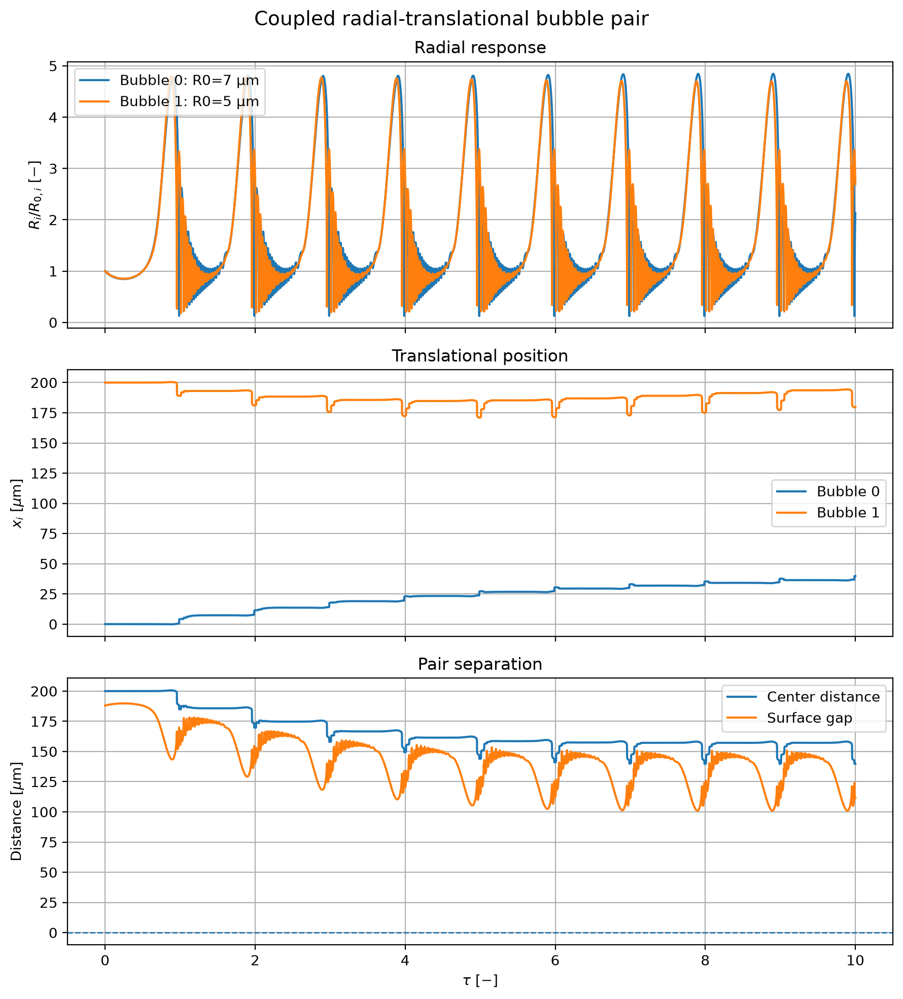
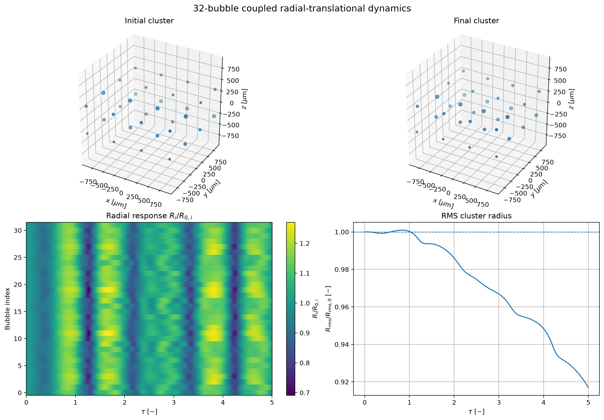

# Multi-Bubble Control

**Reference bubble-dynamics solver and development framework for GPU-accelerated collective acoustic bubble control.**

> **Development status:** The NumPy reference-solver milestone is complete. The current implementation provides tested single- and multi-bubble radial/translational dynamics, an adaptive RKCK45 integrator, collision events, reproducible examples, and validation benchmarks. C++/CUDA acceleration and reinforcement-learning integration are the next development stages.

## Overview

Multi-Bubble Control is a research codebase for investigating the dynamics and control of acoustically driven bubble populations.

The repository is being developed in layers. The current layer is a CPU/NumPy reference implementation used to define and verify the physical and numerical behavior of the models. Future accelerated implementations can then be compared against this reference before they are used in reinforcement-learning environments.

The current reference implementation includes:

- Keller--Miksis single-bubble radial dynamics.
- Fixed-position coupled radial bubble dynamics with instantaneous pressure coupling.
- Single-bubble 3D translational dynamics.
- Coupled radial-translational multi-bubble dynamics.
- Prescribed uniform harmonic and plane standing-wave acoustic fields.
- Batched simulation of independent environments.
- Adaptive Runge--Kutta--Cash--Karp 4(5) integration.
- Generic terminal-event handling with safe-side event localization.
- Bubble-collision terminal events for fixed and translating bubble systems.
- Reproducible examples, numerical benchmarks, and regression tests.

## Reference-solver philosophy

The NumPy implementation is **not intended to be fast or production optimized**. Its purpose is to remain a readable, testable physical and numerical baseline: effectively a numerical oracle against which future C++/CUDA implementations can be checked.

Development of the reference code has been substantially **AI-assisted**. Correctness is therefore not inferred from the implementation itself. The behavior is pinned down through automated verification, including analytical test problems, unit and integration tests, comparisons with SciPy solvers, independent legacy regression data, literature-derived reference trajectories, symmetry and limiting-case checks, and reproducible benchmark cases.

Performance measurements of the NumPy implementation are useful for characterizing the reference workload, but they are not a target for optimization. Performance work belongs to the accelerated backend.

## Numerical models

### Radial dynamics

Single-bubble radial motion is modeled using a Keller--Miksis-type formulation.

The fixed-position multi-bubble model extends the radial equations with instantaneous inter-bubble pressure coupling and solves the resulting coupled acceleration system at each RHS evaluation.

### Translational dynamics

The translating-bubble models augment the radial state with 3D bubble-center position and velocity.

The current implementation includes primary acoustic forcing, viscous drag, and radial-translational bubble interactions. The fully coupled model assembles and solves the radial/translational acceleration system for the complete bubble population.

### Acoustic forcing

The reference implementation currently supports prescribed:

- uniform harmonic pressure forcing;
- plane standing waves with arbitrary 3D direction.

Multiple acoustic components can be combined in one field.

### Collision handling

Coupled bubble simulations can terminate before geometric overlap using the generic terminal-event framework.

For each bubble pair, the collision margin is based on the instantaneous center distance and bubble radii,

```math
g_{ij} = d_{ij} - s_{\mathrm{coll}}(R_i + R_j),
```

where the default safety factor is slightly greater than unity. The minimum pairwise margin defines the terminal event for each environment.

## Integrator

The reference solver uses an adaptive Runge--Kutta--Cash--Karp 4(5) method with independent error control for batched environments.

The implementation supports:

- scalar or component-wise absolute tolerances;
- independently evolving step sizes across environments;
- accepted/rejected-step statistics;
- optional trajectory storage;
- generic terminal events;
- safe-side bisection localization of terminal events.

## Verification

The automated test suite covers both the integrator and the bubble models.

Verification includes:

- analytical exponential-decay, harmonic-oscillator, and non-autonomous ODE problems;
- expected Cash--Karp convergence behavior;
- batched-versus-independent integration equivalence;
- comparison of the single-bubble model against SciPy `DOP853`;
- regression against independent legacy single-bubble reference trajectories;
- single-bubble limits of coupled models;
- equilibrium, symmetry, and coupling-structure checks;
- coupled radial-translational regression against Doinikov Figure 2 reference trajectories;
- terminal-event localization and bubble-collision event tests.

Run the full suite with:

```bash
python -m pytest -v
```

## Installation

Python 3.12 or later is required.

Clone the repository:

```bash
git clone git@github.com:kalmi901/multi-bubble-control.git
cd multi-bubble-control
```

Create a virtual environment:

```bash
python -m venv .venv
```

Activate it on Windows PowerShell:

```powershell
.\.venv\Scripts\Activate.ps1
```

or on Linux:

```bash
source .venv/bin/activate
```

Install the package with development dependencies:

```bash
python -m pip install -e ".[dev]"
```

## Examples

Examples can be run as Python modules from the repository root.

Single-bubble radial dynamics:

```bash
python -m examples.rkck45_single_bubble
```

Fixed-position coupled bubbles:

```bash
python -m examples.rkck45_coupled_bubbles
```

Single translating bubble:

```bash
python -m examples.rkck45_translating_bubble
```

Coupled translating bubble pair:

```bash
python -m examples.rkck45_coupled_translating_bubbles
```

Coupled 32-bubble radial-translational cluster:

```bash
python -m examples.rkck45_coupled_translating_cluster
```

## Reproducible figures and benchmarks

The curated example and benchmark figures can be regenerated from the repository root with:

```bash
bash scripts/generate_figures.sh
```

The script runs the selected reference cases non-interactively and stores figures together with JSON metadata containing the simulation parameters and provenance information.

Generated results are organized under:

```text
examples/figs/
benchmarks/figs/radial/
benchmarks/figs/translational/
benchmarks/figs/performance/
```

Selected reference results:






## Development

Run linting and formatting checks with:

```bash
ruff check .
ruff format --check .
```

Install the pre-commit hooks with:

```bash
pre-commit install
```

GitHub Actions runs the automated checks on pushes and pull requests.

## Roadmap

| Component | Status |
|---|---|
| Python package and CI infrastructure | Completed |
| NumPy single-bubble reference solver | Completed |
| Adaptive RKCK45 integrator | Completed |
| Prescribed acoustic-field models | Completed |
| Fixed-position coupled radial dynamics | Completed |
| Single-bubble translational dynamics | Completed |
| Coupled radial-translational dynamics | Completed |
| Terminal collision-event handling | Completed |
| Numerical verification and reference benchmarks | Completed |
| C++/CUDA accelerated backend | Next |
| PyTorch integration and RL environments | Planned |
| Collective / multi-agent control experiments | Planned |
| GPU performance profiling and optimization | Planned |

The completed Python layer is intended to remain the stable numerical reference while accelerated backends evolve independently.

## License

See [LICENSE](LICENSE) for licensing information.
